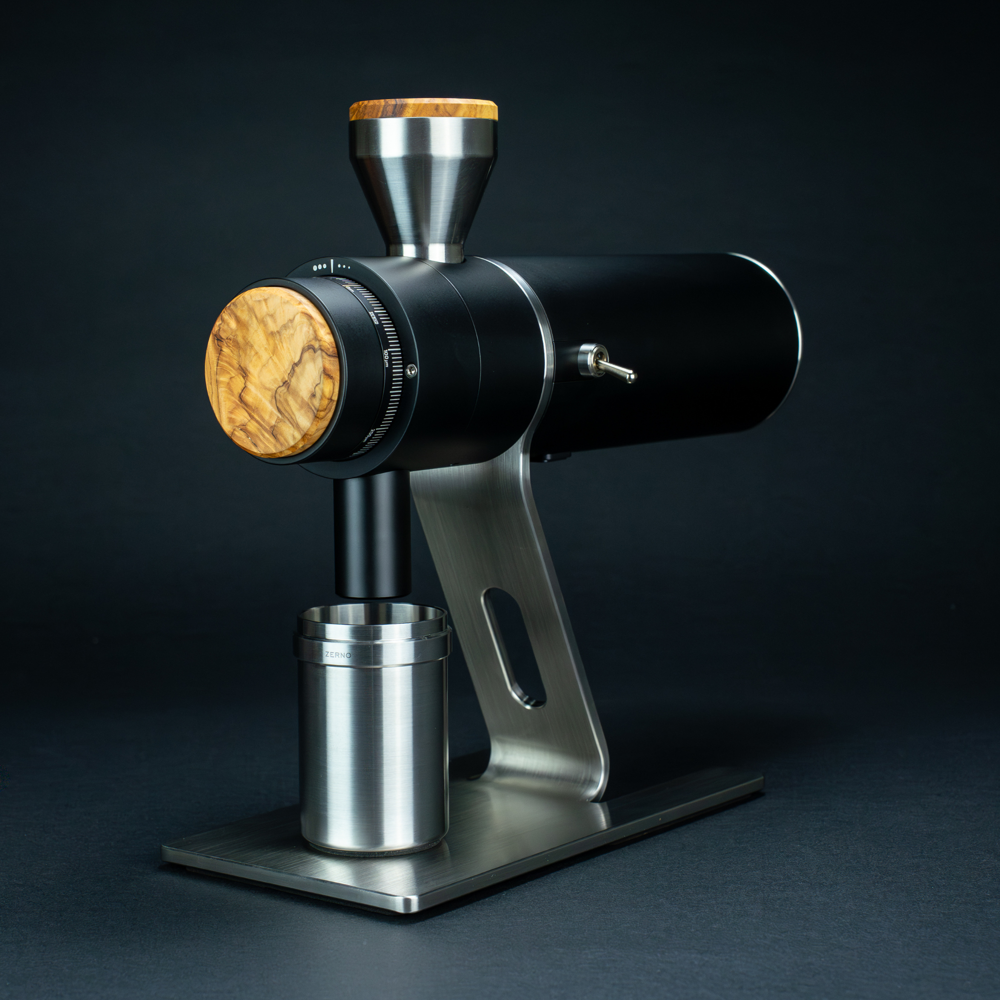

## Brief
In this article, we will focus on the engineering perspective of coffee grinding that contributes to the functionality & quality.

We will ignore the asthetics & art. This is all about engineering.

## Motor
Motor is the heart of the grinder. There are three types of motors: brushed, brushless, and servo motors.

It is usually brushed compared to brushless motors. Servo motor is on a whole different spectrum that most grinders with a big brand name would not use, usually for it's limitation in voltage and big form-factor.

Brushed motor is generally cheaper and used on lower-end grinders. This would trigger customers into thinking that brushed motor is inferior to brushless motors. However, brushed motor generally provides more torque in low rpm. When considering a brushless motor, manufacturers should ensure that the motor functions well in low rpm.

Grinding coffee generally require burr rpm lower than 1500 rpm. Just like fuel engines, the motor delivers more power in high rpm. This is why some grinders have a gearbox to reduce the rpm and increase the torque. As an example, zerno z1 have a 5:1 gear ratio.

Servo motor is simply brushless motor that has precise rpm control. It is large, but has cheap & industry standard solution. It is usually used on DIY grinders.

For either types of motors, a proper driver component that controls the motor's behavior is essential. Make sure you get a good controller and write good software! Some errors in this part can cause unstable rpm, sudden torque jump.

## Alignment
Good alignment is critical for a coffee grinder. There are 2 parts to consider: stationary burr alignment and rotating burr alignment.

Most grinders move the stationary burr to adjust the grind size, with only a few exceptions like Zerno Z1. It turned out to be a inferior idea, as they switched to adjust the stationary burr for Z2.

#### Stationary Burr Alignment
To ensure total alignment, grinder needs to make sure the fixed burr is aligned at the base, and the dial doesn't break the alignment.

To align the fixed burr at the base, The grinder body is either aligned by its structure, or have some alignment mechanism to allow customers to adjust the alignment later. For example, there could be 4 bolts controlling each corner of the stationary burr carrier. To realign, adjust the bolts until the burr is aligned.

For the first alignment solution, the grinder body should be machined very precisely. Manufacturer either needs super precise CNC machine, or use more stable materials like stainless steel over aluminum alloy.

Examples of align-by-structure grinders are Zerno lineup, Lagom lineup, SG98. Other ultra grinders have realignment mechanism achieved via bolts and strings.

#### Rotary Burr Alignment
This one is not user-adjustable. Manufacturers really need to put effort to ensure the alignment of it. Remember, the rotary burr carrier is connected to the motor shaft, either directly or indirectly. If connected directly, the motor really need a very high precision.

The other solution is to connect the motor to a bearing, and connect bearing to the rotary burr carrier. The bearing is precisely positioned, eliminating any shaking from the motor. Again, when looking for coffee grinders, check if they put extra cost to add bearings for better alignment.

## Dialing
Dialing is a topic closely tied to alignment. Again, dialing structure can either be simple or complicated.

The simple design is to make a precise bolt structure. When screwed in, the bolt would push the stationary burr carrier in, making smaller gap for smaller particle size. When screwed out, the bolt would leave space for the upper burr carrier. The stationary burr carrier is pushed by strings to fill the gap, giving more space for larger particle size.

Of course the bolt is a rotating structure, so it would rotate on the upper burr carrier. A bearing is needed to avoid friction and damage to the grinder.

This is cool, but this relies on the stationary burr carrier to be pushed up properly when dialing leaves more space. For example, Ye ultra is manufactured to have very tight tolerance, meaning the four pillar supporting the upper grinder structure is very tight, and hard to move without polishing. This would cause flaky zerno point, as four corners do not move the same distance when changing burr gap. The solution is to polish pillars, making it less tight.

Some other grinders put more emphasis on the dialing mechanism. The dialing mechanism isn't just a bolt, but also an entire mechanism to ensure alignment and low friction. Examples are lagom & zerno.
